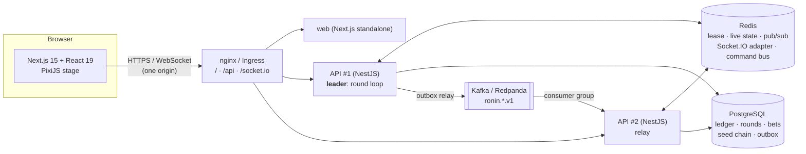
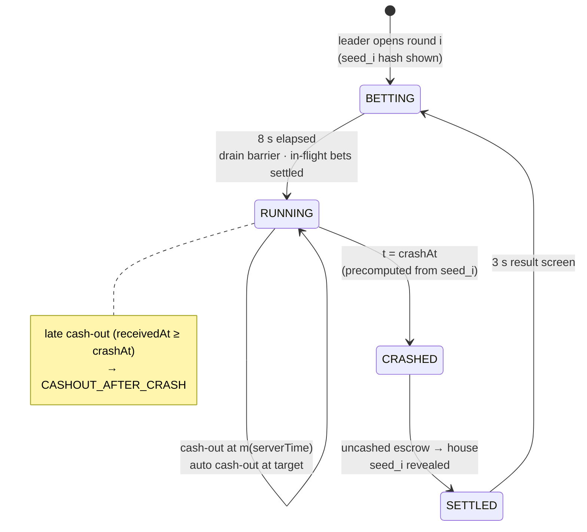
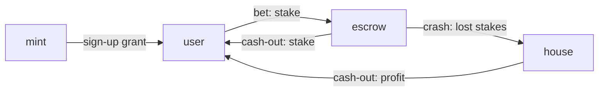

# Ronin Rush

A live, shared-round **crash game**. A ronin duels an oni in a bamboo forest at night. While the
ronin holds out, a multiplier climbs. Every player watches the same round and cashes out whenever
they choose. When the oni lands the final blow, everyone still in loses their stake.

It is a portfolio project about the hard parts behind a game like this: **real-time
architecture, provable fairness, a server that owns the clock, and a wallet that can't
double-spend**.

> **Play money only.** Balances are in *ryō*, a fictional coin. There are no real payments,
> deposits or withdrawals. The UI shows a responsible-gaming notice and a session timer.

```bash
docker compose up --build        # → http://localhost:8080   (2 API replicas, nginx, Postgres, Redis, Redpanda)
```

---

## Contents

1. [Rules](#rules)
2. [Provably fair](#provably-fair)
3. [Why the server owns the clock](#why-the-server-owns-the-clock)
4. [Architecture](#architecture)
5. [Round state machine](#round-state-machine)
6. [Wallet: double-entry ledger](#wallet-double-entry-ledger)
7. [Events (Kafka)](#events-kafka)
8. [How it scales](#how-it-scales)
9. [Running it](#running-it) · [Tests](#tests) · [Deployment](#deployment)
10. [Asset credits](#asset-credits) · [Responsible gaming](#responsible-gaming)

## Rules

| Phase | Duration | What happens |
|---|---|---|
| **Betting** | 8 s | Place a stake, optionally with an *auto cash-out* (e.g. 2.00×). Everyone sees the same countdown. |
| **Fight** | until the crash | The multiplier starts at 1.00× and grows as **m(t) = e^(k·t)**, with k ≈ 0.00006 per ms (2.00× after ~11.6 s). Press **Cash out** to lock in the current multiplier. |
| **Defeat** | instant | At the pre-committed crash point the oni lands the final blow. Bets not cashed out are lost: "DEFEATED ×3.41". |
| **Result** | 3 s | Payouts, the round's revealed seed and a link to verify it. Then the next round starts. |

The animation follows the multiplier. From 1.00× to 2.00× the fighters trade normal sword blows.
From 2.00× to 5.00× the oni enrages: faster attacks, sparks and camera shake on parries. Above
5.00× is frenzy mode, with an aura and slow-motion parries. The crash plays a final blow and a
screen flash.

## Provably fair

The house cannot pick a crash point after seeing the bets, and anyone can check this.

**Hash chain.** Before launch the server generates a chain of N seeds working backwards:
`seed_N` is random, and `seed_i = SHA256(seed_{i+1})`. It publishes only the **commitment**
`SHA256(seed_1)`. Round *i* uses `seed_i`, which is revealed once the round settles. Hashing a
revealed seed gives the previous round's seed, and from round 1 it gives the commitment. Because
SHA-256 can't be inverted, future seeds stay unpredictable while past ones are verifiable.

**Crash point.**

```
h          = first 52 bits of HMAC-SHA256(key = seed, message = publicSalt)
U          = h / 2^52                                  (uniform in [0, 1))
crashPoint = max(1.00, floor(99 / (1 − U)) / 100)
```

This gives **P(crash ≥ x) ≈ 0.99 / x**, a 1% house edge. The arithmetic runs in `BigInt`
(`floor(99·2^52 / (2^52 − h))`) so server and browser agree to the last cent. About 2 rounds
in 101 bust instantly at 1.00×.

**Verify it yourself.** The `/verify` page recomputes any round's crash point *in the
browser*. It uses the same pure functions as the server, from `packages/shared`, including a
synchronous SHA-256/HMAC that has no dependency on WebCrypto. The page also walks the chain back
to the commitment.

**Tested statistically.** `packages/shared/test/distribution.test.ts` simulates
**1,000,000 rounds** and checks the empirical survival curve against 0.99 / x at several
multipliers, within tolerance.

## Why the server owns the clock

The multiplier is a function of time, so whoever controls the clock controls the payout. Every
decision therefore uses **server time**:

- The leader broadcasts each round's `startedAt` in server time. Clients estimate their **offset
  and latency** with an NTP-style ping/pong. With four timestamps (client send c0, server
  receive s1, server send s2, client receive c3): offset = `((s1 − c0) + (s2 − c3)) / 2` and
  rtt = `(c3 − c0) − (s2 − s1)`. Only the lowest-RTT samples are trusted. They then render `m(t)`
  locally at 60 fps. The header shows each player's latency.
- A **cash-out request carries no multiplier.** The server pays
  **m(serverReceiveTime − startedAt)**, never the client's number.
- If the request **arrives after the crash** instant, it is rejected with `CASHOUT_AFTER_CRASH`,
  even if the player's screen still showed the round running. The Playwright suite has a test
  that does exactly this.
- **Auto cash-out** runs on the server at the exact target multiplier, provided the target is
  below the crash point.
- All instances align to one shared clock (Redis `TIME`), so it doesn't matter which API
  instance receives the request.

The rule lives in one pure function, `decideCashout(receivedAt, startedAt, crashAt, crashX100, k)`,
which is unit-tested at the boundaries.

## Architecture



- **One leader runs the round loop.** Every instance competes for a Redis lease (`SET NX PX`,
  renewed with a Lua script). The lease comes with a **fencing token** that increases on every
  takeover. Each state transition and ledger operation checks the token against a `leader_fence`
  row in Postgres, so a paused ex-leader that wakes up can't write anything.
- **Other instances relay.** A bet that reaches API #2 goes through a Redis Streams command
  bus to the leader and back. A drain barrier makes sure every instance has forwarded its
  in-flight commands before the betting window closes.
- **Persist, then broadcast.** A round event reaches clients only after its database
  transaction commits. If the leader dies, the new one resumes from Postgres.
- **Socket.IO with the Redis adapter.** Any instance can emit to every client. Bets and
  cash-outs are coalesced into a `round:batch` message every 100 ms, while phase changes go out
  immediately.

## Round state machine



Transitions are scheduled at nominal instants (`startedAt + bettingMs`, `crashAt`, …), not
"after the previous step finished", so the timeline can't drift. Decisions (is the window open?
what is the multiplier at receive time? has this bet already cashed out?) run in a serial
queue. **Ledger writes run concurrently**: each transition drains the set of in-flight writes
before it commits, so no write can straddle two phases.

## Wallet: double-entry ledger

Every movement of money is a balanced transaction of postings that sum to zero.



| Operation | Postings (cents) |
|---|---|
| Bet 10.00 | user −1000, escrow +1000 |
| Cash out at 2.50× | escrow −1000, house −1500, user +2500 |
| Round crashes, bet lost | escrow −1000, house +1000 |

Guarantees enforced **by the database**, not only by code:

- A **deferred constraint trigger** rejects any transaction whose postings don't sum to zero.
- Postings and transactions are **append-only** (UPDATE/DELETE triggers raise).
- `CHECK (balance >= 0)` on the cached user balance, updated under `SELECT … FOR UPDATE`, so the
  same coins can't be spent twice. A second concurrent bet waits for the first, then fails.
- An **idempotency key** on every operation, claimed with `INSERT … ON CONFLICT DO NOTHING`
  in the same transaction. A retried request returns the original result instead of paying
  again.
- Ledger operations take a `FOR SHARE` lock on the leader fence, so a deposed leader's write
  fails.

`apps/api/test/ledger.concurrency.test.ts` fires **500 concurrent bets and cash-outs**
against real Postgres. It checks that no balance goes negative, nothing is paid twice, and the
sum of every account balance is exactly zero.

## Events (Kafka)

Domain events are versioned: `ronin.round.started.v1`, `ronin.bet.placed.v1`,
`ronin.bet.cashed_out.v1`, `ronin.round.crashed.v1`, `ronin.round.settled.v1` (and
`system.health.reported.v1` in platform mode).

They are published through a **transactional outbox**. The event row is inserted in the same
Postgres transaction as the ledger change, and a relay on every instance publishes pending rows
(`FOR UPDATE SKIP LOCKED`, at-least-once, stable `event-id` header for dedupe). There can't be a
paid cash-out without its event, or an event for a bet that never happened. If Kafka is down,
events wait in the outbox and the game keeps running.

To prove the round trip, the API also runs a **consumer group** (`<client-id>-system-view`)
that reads the topics back. The System view shows topic, partition, offset, consumer lag and the
end-to-end delay from database commit to consumption. With `KAFKA_BROKERS` empty, the relay runs
in dry-run mode: rows are marked and shown, but nothing is sent.

## How it scales

- **Stateless API instances** behind any L7 proxy. Only the leader does round work, and the
  others take connections and relay commands. Adding instances adds WebSocket capacity.
  Leadership fails over within the lease TTL (5 s), and the new leader resumes the round from
  Postgres.
- **Per-round work is O(bets), not O(bets × sockets).** Broadcasts are batched, and balances are
  pushed only to their owner.
- **Load test** (`load/players.k6.js`): 1,000 simulated players over real WebSockets. The
  first run exposed serialized ledger writes (bet ack p95 ≈ 15 s). After pipelining and
  batching, a probe client measured **bet ack p95 7 ms, cash-out ack p95 7 ms** while 1,000
  players were connected. Details and caveats are in [`load/README.md`](load/README.md).
- What would come next: shard rounds per "table", move the read model to a replica, and
  partition the outbox relay by key.

## Running it

**Everything in Docker:** `docker compose up --build`, then open <http://localhost:8080>.
Open the **System view** in the header to watch the leader, clock offsets, bets per second,
Kafka offsets and the ledger sum (always 0).

**Development (hot reload):**

```bash
pnpm install
docker compose up -d postgres redis redpanda      # or your own services
cp apps/api/.env.example apps/api/.env             # adjust URLs if needed
pnpm dev:api                                       # http://localhost:3001
pnpm dev:web                                       # http://localhost:3000
```

| Variable | Default | Meaning |
|---|---|---|
| `GROWTH_K` | `0.00006` | Curve speed k (per ms) |
| `BETTING_MS` / `RESULT_MS` | `8000` / `3000` | Phase durations |
| `BOTS_COUNT` | `12` | Bots that bet and cash out so the table is never empty |
| `KAFKA_BROKERS` | empty | Comma-separated brokers; empty = outbox dry-run |
| `PLATFORM_MODE` | `false` | `true` = authenticate with platform-core JWTs (RS256) and report health events |
| `SENTRY_DSN` / `NEXT_PUBLIC_SENTRY_DSN` | empty | Optional error tracking (the browser SDK loads lazily, only when set) |

**Monorepo layout:**

```
apps/api         NestJS 11: round engine, leader election, ledger, Socket.IO gateway, outbox relay, Kafka consumer
apps/web         Next.js 15 + React 19 + Tailwind 4 + PixiJS 8: game, verify, my bets, leaderboard, system view
packages/shared  Pure isomorphic code: fairness, multiplier curve, clock sync, zod schemas, event types
e2e              Playwright suite        load   k6 script        deploy   Docker, nginx, Helm, NAS scripts
```

## Tests

```bash
pnpm test        # Vitest: fairness (incl. 1M-round distribution), timing, state machine, failover,
                 # ledger + 500-op concurrency, command bus, leader election, pipelining
                 # (set TEST_DATABASE_URL and REDIS_URL to run the Postgres/Redis suites)
pnpm test:e2e    # Playwright: bet → cash out → payout; late cash-out rejected; verify page
pnpm load        # k6: 1,000 simulated players
```

CI (GitHub Actions) runs typecheck, all suites against real Postgres and Redis, Playwright,
Docker builds for the three images, `helm lint` with kubeconform, and validation of both Compose
files.

## Deployment

- **Docker Compose (local):** `docker-compose.yml`, one command.
- **Kubernetes:** `deploy/helm/ronin-rush`, with API and web Deployments, PDB, optional HPA, and
  an Ingress that serves `/`, `/api` and `/socket.io` on one host with sticky sessions and a
  `frame-ancestors` CSP.
- **Home server (Synology NAS + Tailscale Funnel)**, the live portfolio demo: see
  [`docs/deploy-nas.md`](docs/deploy-nas.md). It covers building `linux/amd64` images, the
  `docker save`/SHA-256 transfer, deploy, update, rollback, database backup and restore, and
  the iframe embed.

## Asset credits

- Fighter sprites: **Samurai** by **Nastanliev** (<https://nastanliev.itch.io/samurai>), CC0,
  in the recoloured variants *Midnight Slash* (ronin) and *The Dark Red One* (oni). They are
  based on **Martial Hero** by **LuizMelo** (<https://luizmelo.itch.io/martial-hero>), CC0.
- Fonts: **Shippori Mincho B1** and **Zen Kaku Gothic New** (SIL Open Font License), via Fontsource.
- Scene, effects and sounds are drawn and synthesised in code. There are no third-party
  characters, brands or logos.

## Responsible gaming

This is a technical demonstration. It uses play money with no cash value, and no purchase is
possible. The game still shows what a responsible operator would show: a permanent notice and a
session timer. Crash games can be compulsive. If gambling stops
being fun for you or someone you know, organisations such as BeGambleAware
(<https://www.begambleaware.org>) or, in Spain, FEJAR (<https://www.fejar.org>) can help.
