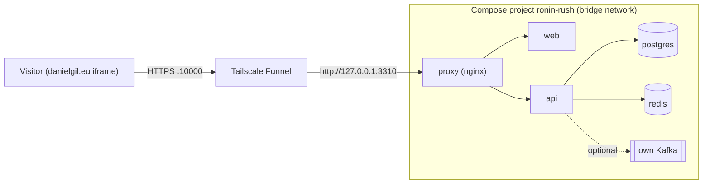

# Deploying the live demo on a Synology NAS (Tailscale Funnel)

The portfolio demo runs on a Synology DS918+ at home and is published to the internet through
**Tailscale Funnel**. danielgil.eu (hosted elsewhere) embeds it in an iframe. It is an
independent Compose project: its own folder, project name, credentials, volumes and loopback
ports. Other stacks on the NAS (SpotKick, platform-staging) are not touched.

| | |
|---|---|
| NAS | DS918+, x86_64, 4 GB RAM, DSM 7.1.1, Docker 20.10.3, docker-compose 1.28.5, Tailscale 1.58 |
| Folder | `/volume1/docker/ronin-rush` |
| Compose project | `ronin-rush` (file format **2.4**: `mem_limit`, health conditions, profiles; no newer syntax) |
| Public URL | `https://magnum-play.tail55a5b1.ts.net:10000` |
| Local ports | `127.0.0.1:3310` → nginx (web + `/api` + `/socket.io`) · `127.0.0.1:3311` → API (diagnostics only) |
| Not exposed | Postgres, Redis, Kafka (no published ports), DSM, SSH |



Memory limits: postgres 256 MB, redis 64 MB, api 384 MB, web 192 MB, proxy 64 MB. Real use
is about 350–400 MB. The optional own Kafka adds a 640 MB cap.

## Files

| In the repo | On the NAS | Purpose |
|---|---|---|
| `Dockerfile` | — | Multi-stage build: targets `api`, `web`, `proxy` |
| `deploy/release.ps1` / `release.sh` | — | Build `linux/amd64` images tagged with the commit, `docker save`, SHA-256 |
| `deploy/nas/docker-compose.yml` | `docker-compose.yml` | The stack |
| `deploy/nas/docker-compose.platform-kafka.yml` | same | Optional: join an existing platform Kafka network |
| `deploy/nas/env.example` | `.env` (**secrets, chmod 600, never in git**) | Created by `init.sh` with random secrets |
| `deploy/nas/*.sh` | same | `init`, `deploy`, `rollback`, `backup-db`, `restore-db`, `smoke` |
| `deploy/portfolio/embed-snippet.html` | — | The iframe block for danielgil.eu |
| `deploy/portfolio/staging.html` | — | Rehearsal page with the embed |

The frontend is built with an **empty `NEXT_PUBLIC_API_URL`**, so the browser calls `/api` and
`/socket.io` on its own origin. The public URL is therefore not baked into the bundle, and the
same image works on any host. CORS stays closed (`CORS_ORIGIN` = the public origin), and nginx
sends `Content-Security-Policy: frame-ancestors 'self' https://danielgil.eu https://www.danielgil.eu http://127.0.0.1:8081`.

## First install

1. **Folder** (on the NAS over SSH):
   ```sh
   sudo mkdir -p /volume1/docker/ronin-rush && sudo chown "$USER" /volume1/docker/ronin-rush
   ```
2. **Copy the deploy files** (on the PC, from the repo root; one tarball, so no shell globbing is needed):
   ```powershell
   tar -cf ronin-deploy.tar -C deploy/nas .
   scp ronin-deploy.tar USER@192.168.1.39:/volume1/docker/ronin-rush/
   ```
   then on the NAS: `cd /volume1/docker/ronin-rush && tar -xf ronin-deploy.tar && rm ronin-deploy.tar`.
   DSM's SSH server needs SFTP enabled for modern `scp`. If it fails, add `-O` (legacy protocol).
3. **Initialise** (NAS): `cd /volume1/docker/ronin-rush && sudo sh init.sh` creates the
   `data/`, `releases/` and `backups/` folders and a `.env` with random `POSTGRES_PASSWORD`
   and `JWT_SECRET`.
4. **Build a release** (PC, Docker Desktop):
   `powershell -ExecutionPolicy Bypass -File deploy\release.ps1 -NasUser USER`.
   It prints the exact `scp` and deploy commands.
5. **Upload and deploy:** run the printed `scp`, then on the NAS `sudo sh deploy.sh <tag>`.
   The script checks the SHA-256, runs `docker load`, starts the stack, waits for health checks
   and runs `smoke.sh`.
6. **Publish with Funnel** (NAS). Port 10000 is one of the three ports Funnel allows. This adds
   a route and leaves 443 and 8443 as they are:
   ```sh
   sudo tailscale funnel --bg --https=10000 http://127.0.0.1:3310
   tailscale serve status        # 443 → 3300 and 8443 → 3301 must still be listed
   ```
7. **Check from outside** (mobile data, not home Wi-Fi): open the public URL, play a whole
   round as a guest, and try a second browser and a reconnection (toggle airplane mode).

## Update

```text
PC:   commit → deploy\release.ps1 → scp bundle + .sha256 to releases/
NAS:  sudo sh deploy.sh <new-tag>
```

`deploy.sh` backs up the database first (`backups/ronin-<date>-<old-tag>.dump`), records the
previous tag in `.previous-tag`, switches `RONIN_TAG` in `.env` and recreates only the
containers that changed. Migrations run on API start, inside an advisory lock.

## Rollback

```sh
sudo sh rollback.sh                                   # back to .previous-tag (images are still loaded)
sudo sh rollback.sh <tag>                             # to a specific tag
sudo sh rollback.sh <tag> backups/<file>.dump         # also restore the database taken before that update
```

Restore the database only if the newer version ran a migration the older code can't read. The
restore stops the API, recreates the database from the dump and clears Redis's live round state.

Old bundles in `releases/` and images can be pruned once you no longer need to roll back to
them: `sudo docker image rm ronin-rush-{api,web,proxy}:<tag>`.

## Kafka on the NAS

Three modes, chosen in `.env`:

| Mode | `.env` | Extra RAM |
|---|---|---|
| Dry run | `KAFKA_BROKERS=` | 0. The outbox is drained and shown, but nothing is sent |
| Own broker | `KAFKA_BROKERS=127.0.0.1:9092` (scripts add `--profile kafka`) | ≤ 640 MB |
| Platform broker | not supported on this NAS (shared network namespace, and see below) | — |

**Why the platform broker is not used here.** On this NAS the `platform-staging` stack runs its
containers in one shared network namespace (they all sit behind the Redis container) and its Kafka
listens on `127.0.0.1:19092` only. That address is reachable from inside that namespace, not from
another compose project. Joining it would mean changing the other stack or attaching to its
namespace, which would make Ronin Rush depend on it. The own broker uses the same
`apache/kafka:3.9.1` image already on the NAS, so there is nothing new to download.

In the Kafka modes the API also consumes its own topics with a consumer group. The System view
shows topic, partition, offset, lag and the delay from database commit to consumption. If the
broker is down the game is unaffected, and events wait in the outbox.

## Troubleshooting

- **`docker load` fails with `open /volume1/@docker/tmp/docker-import-…/repositories: no such file or directory`.**
  The NAS runs Docker 20.10, which only loads archives that contain a Docker `manifest.json`.
  Docker Desktop adds provenance attestations by default, which turns each image into an index,
  and `docker save` then writes an OCI-only archive without that file. The release scripts build
  with `--provenance=false --sbom=false` and refuse to finish if `manifest.json` is missing.
  Bundles made by older versions of `release.ps1` also wrapped that archive in a second tar;
  `deploy.sh` unwraps them, and `release.ps1` now writes a plain gzip like `release.sh`.

- **Health and logs:** `sh smoke.sh`, `sudo docker-compose -p ronin-rush ps`,
  `sudo docker-compose -p ronin-rush logs --tail 100 api`.
- **Connections between containers time out although the names resolve.** Reproduced on this
  NAS on 2026-11-11: from the API container, TCP to postgres, redis and web all timed out on the
  bridge network, while each service was healthy on its own. Like SpotKick and platform-staging,
  the stack therefore shares one network namespace: postgres, api, web, proxy and kafka use
  `network_mode: service:redis`, connect through `127.0.0.1`, and the published ports
  (`127.0.0.1:3310`, `127.0.0.1:3311`) sit on the redis service. The namespace belongs to
  ronin-rush alone. Check it from inside the API container:
  ```sh
  sudo docker exec ronin-rush_api_1 node -e "require('net').connect(5432,'127.0.0.1').on('connect',()=>{console.log('tcp ok');process.exit()}).on('error',e=>{console.log(e.message);process.exit(1)})"
  ```
- **API unhealthy on the first start, then healthy minutes later.** A cold start on the NAS
  spends about 90 s just loading modules (Sentry ~40 s, Nest, TypeORM), with no log output until
  Nest starts. The NAS compose gives the API a 300 s start period and `deploy.sh` waits up to 7 min.
- **`UnixHTTPConnectionPool … Read timed out (read timeout=60)` during `deploy.sh`.** docker-compose
  stopped waiting for the Docker daemon while it recreated a container (the NAS is slow right
  after loading a release). The scripts now set `COMPOSE_HTTP_TIMEOUT=300`; with an older copy,
  run `sudo env COMPOSE_HTTP_TIMEOUT=300 sh deploy.sh <tag>` again: it is safe to repeat.
- **`sudo: docker-compose: command not found`** in a manual command: DSM's sudo has a short PATH.
  Use `sudo /usr/local/bin/docker-compose …`; the scripts set the PATH themselves.
- **Blank iframe:** the browser console shows `frame-ancestors` if the embedding page isn't
  listed in `FRAME_ANCESTORS` in `.env`. Add it and run `sudo docker-compose -p ronin-rush up -d proxy`.
- **Funnel:** `tailscale funnel status`. To remove only this route:
  `sudo tailscale funnel --https=10000 off`.

## Portfolio embed

Paste [`deploy/portfolio/embed-snippet.html`](../deploy/portfolio/embed-snippet.html) into the
page. It is responsive (fixed height on desktop, about 88% of the viewport on phones), has an
accessible title, uses `loading="lazy"` and links to open the game in a new tab. Rehearse with
`deploy/portfolio/staging.html` first. Bots bet every round, so a visitor can play
immediately as a guest without waiting for anyone.
