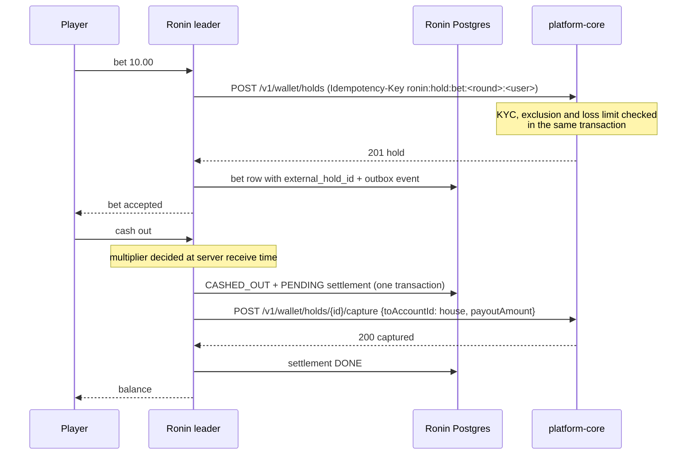

# PLATFORM_MODE: running Ronin Rush inside the platform

With `PLATFORM_MODE=true`, Ronin Rush stops being a standalone game with its own users and
play-money wallet. It becomes one service of the ecosystem described in
`@danigil/platform-contracts`. **platform-core** owns identity, the wallet and
responsible-gaming rules. Ronin owns the round, the timing and the fairness proof.

| Concern | Standalone (default) | `PLATFORM_MODE=true` |
|---|---|---|
| Players | Own users and guests, HS256 sessions | Core RS256 user tokens verified through Core's **JWKS** (`kid`, rotation, fail closed); service tokens are refused as players |
| Money | Local double-entry ledger | **Core wallet holds**: stake → `POST /v1/wallet/holds` (`purpose: stake`), cash-out/loss → `capture` into the house with `payoutAmount` |
| Responsible gaming | Notice and session timer | Plus **Core's limits**: KYC, cool-off, self-exclusion and daily loss limit are enforced by Core inside the hold transaction. A refusal reaches the player as `RESPONSIBLE_GAMING_BLOCKED` |
| Events | `ronin.*.v1` in the platform envelope | Same, plus `system.health.reported.v1` every 30 s (status, p95 latency, error rate) |
| Bots | Local ledger | Still local: they have no platform identity |

## Money flow



- **The decision never waits for Core.** Cash-outs and losses commit locally together with a
  `platform_settlements` row, a command outbox. The capture is tried immediately and then
  retried every second, with exponential backoff, on every instance. Rows are leased with
  `FOR UPDATE SKIP LOCKED`, and the Core idempotency key `ronin:capture:<betId>` makes
  duplicates harmless.
- **Bets do wait for Core.** Money must be reserved before a bet is accepted. If Core refuses,
  nothing is recorded. If Ronin can't record the bet after Core reserved the money (for example,
  the leader was fenced out), the hold is **released**. If the hold call's outcome is ambiguous
  (timeout or 5xx), Ronin replays the same key later and releases whatever it returns.
- The System view shows pending captures, Core call counts and failures, and Core p95 latency.

## Configuration

```env
PLATFORM_MODE=true
PLATFORM_CORE_URL=http://core-api:3001
PLATFORM_JWKS_URL=http://core-api:3001/.well-known/jwks.json
PLATFORM_JWT_ISSUER=http://localhost:3001        # Core's JWT_ISSUER
PLATFORM_JWT_AUDIENCE=platform-core              # Core's JWT_AUDIENCE
PLATFORM_CLIENT_ID=ronin-rush
PLATFORM_CLIENT_SECRET=<from Core's operator>
PLATFORM_HOUSE_ACCOUNT_ID=<uuid of Core's house account>
PLATFORM_CURRENCY=EUR
KAFKA_BROKERS=kafka:9092                         # the platform's broker
```

Provisioning in Core (operator):

1. Register a service client `ronin-rush` with scopes `wallet:legacy:read wallet:legacy:write`.
   Hash its secret the way Core's seed does for `local-service`.
2. Find the house account: `SELECT id FROM accounts WHERE kind = 'house' AND currency = 'EUR';`

Players arrive from a platform page that opens the game with `#platform_token=<Core user JWT>`.
The fragment never reaches a server or a `Referer`, and the web app removes it from the address
bar immediately. Core user tokens are short-lived (10 minutes). The socket session is
authenticated at the handshake, and a longer stay on REST pages needs the portal to hand over a
fresh token. A proper refresh flow is the next step.

Tested in `apps/api/test/platform-ledger.test.ts`, against real Postgres and an HTTP stand-in for
Core that follows the wallet contract. The tests cover a hold, then a capture with payout; a
retried bet creating one hold; insufficient funds and responsible-gaming refusals recording
nothing; Core down during a cash-out, with the decision kept and the capture applied exactly
once when Core is back; a mixed round where platform losses are captured and bot losses posted
locally; and a hold released when the bet can't be recorded.
