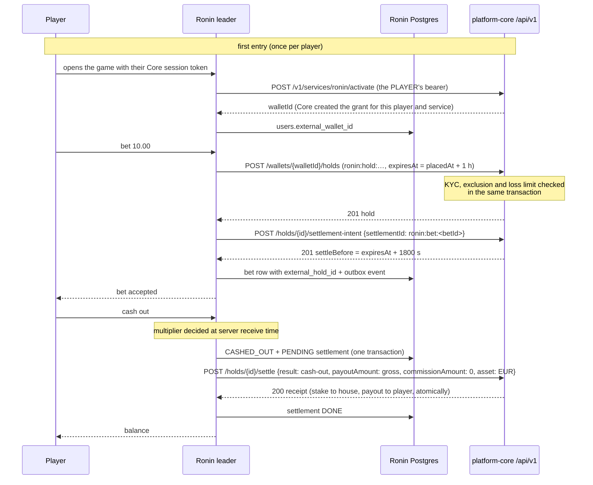

# PLATFORM_MODE: running Ronin Rush inside the platform

With `PLATFORM_MODE=true`, Ronin Rush stops being a standalone game with its own users and
play-money wallet. It becomes one service of the ecosystem described in
`@danigil/platform-contracts`. **platform-core** owns identity, the wallet and
responsible-gaming rules. Ronin owns the round, the timing and the fairness proof.

| Concern | Standalone (default) | `PLATFORM_MODE=true` |
|---|---|---|
| Players | Own users and guests, HS256 sessions | Core RS256 user tokens verified through Core's **JWKS** (`kid`, rotation, fail closed); service tokens are refused as players |
| Money | Local double-entry ledger | **Core wallet holds on `/api/v1`**: stake → `createHold` (`purpose: stake`) + settlement intention, cash-out/loss → `settleHold` (stake into the house and the gross payout to the player, one Core transaction) |
| Responsible gaming | Notice and session timer | Plus **Core's limits**: KYC, cool-off, self-exclusion and daily loss limit are enforced by Core inside the hold transaction. A refusal reaches the player as `RESPONSIBLE_GAMING_BLOCKED` |
| Events | `ronin.*.v1` in the platform envelope | Same, plus `system.health.reported.v1` every 30 s (status, p95 latency, error rate) |
| Bots | Local ledger | Still local: they have no platform identity |

## Money flow



- **The decision never waits for Core.** Cash-outs and losses commit locally together with a
  `platform_settlements` row, a command outbox. The settle is tried immediately and then
  retried every second, with exponential backoff, on every instance. Rows are leased with
  `FOR UPDATE SKIP LOCKED`, and the Core idempotency key `ronin:settle:<betId>` makes
  duplicates harmless (Core replays the receipt, even after the deadline).
- **Bets do wait for Core, and for the settlement window.** Money must be reserved, and the
  intention confirmed, before a bet is accepted. If Core refuses either, nothing is recorded: a
  definitive refusal releases the hold; an ambiguous outcome (timeout, 5xx, lost answer) is
  unwound by replaying hold, intention and a `void` settle with their own keys, so the net effect
  is zero whatever Core had committed. If Ronin can't record the bet after the intention exists
  (for example, the leader was fenced out), the stake goes back through the same `void` settle,
  because Core refuses a plain release once an intention exists.
- **Settlement window.** A hold lives 1 h (`CORE_HOLD_TTL_SECONDS`); with the intention, Core keeps
  the funds held and the settle possible for 1800 s beyond that (fixed by Core). Past that
  deadline the settle can never succeed and Core refunds the stake. Ronin parks that row as
  `FAILED` (it is not retried), counts it in `ronin_platform_settlements_failed_total` and
  degrades `/health` with the reason. A player who had **won** while Core was unreachable for
  more than about 90 minutes is owed the winnings: this is a manual reconciliation item, listed
  under "Not verified".
- A player who has not been activated (Core was down at first entry) has no wallet: bets answer
  `WALLET_UNAVAILABLE` and activation is retried on the player's next authenticated request.
- The System view shows pending settlements, Core call counts and failures, and Core p95 latency.

## Configuration

```env
PLATFORM_MODE=true
SERVICE_NAME=ronin-rush
CORE_URL=http://core-api:3001
CORE_JWKS_URL=http://core-api:3001/.well-known/jwks.json
CORE_ISSUER=http://localhost:3001                # Core's JWT_ISSUER (must be a URL)
CORE_AUDIENCE=platform-core                      # Core's JWT_AUDIENCE
CORE_CLIENT_ID=ronin                             # Core's service client id
CORE_SERVICE_ID=ronin                            # service id for player activation (defaults to CORE_CLIENT_ID)
CORE_HOLD_TTL_SECONDS=3600                       # life of a stake hold; settle stays possible 1800 s after it
CORE_CLIENT_SECRET=<from Core's operator>
CORE_CURRENCY=EUR
# CORE_TOKEN_URL defaults to CORE_URL/oauth/token. The pre-0.2.0 PLATFORM_* names still work.
# CORE_HOUSE_ACCOUNT_ID is no longer used (accepted and ignored): settle credits Core's own house.
KAFKA_BROKERS=kafka:9092                         # the platform's broker
PORTAL_ORIGINS=https://portal.example            # who may hand over renewed tokens (postMessage)
```

For running it inside platform-infra (compose services, database and role, topics, Core client,
Prometheus, NAS staging, memory budget) see [`platform-infra-additions.md`](platform-infra-additions.md).

Provisioning in Core (operator), with Core's own scripts: `pnpm db:migrate`, `pnpm db:seed`, then
`pnpm db:seed:services` with `SERVICE_CLIENT_SECRETS_FILE` (a private JSON with a secret of at
least 32 characters for `ronin`). That creates the `ronin` client with scopes
`wallet:read wallet:write wallet:legacy:read wallet:legacy:write rg:check` and its system grants
(house, rake). Ronin only uses `wallet:read wallet:write`. No SQL and no per-player grant by the
operator: each player's grant is created by Core when that player's own token activates Ronin.

Players arrive from a platform page that opens the game with `#platform_token=<Core user JWT>`.
The fragment never reaches a server or a `Referer`, and the web app removes it from the address
bar immediately.

## Token expiry and renewal

Core user access tokens live 600 s, and the game never holds a refresh token: the portal owns
the session (`@danigil/platform-contracts` 0.2.0, `docs/auth.md`). Ronin's side:

- **No acceptance past `exp`.** Each socket remembers its token's expiry. At that moment the
  server emits `auth:expired`; commands (bet, cash-out) are refused with `AUTH_EXPIRED` from then
  on. The socket stays open, so the player keeps watching the round.
- **Expiry never touches money already committed.** A bet placed with a valid token is settled by
  the server at the round outcome, auto cash-out included (covered by
  `apps/api/test/auth-renewal.e2e.test.ts`, where the server pays a 1.30x auto cash-out after the
  token lapsed).
- **Renewal without reconnecting.** `auth:renew { token }` (with ack) swaps the socket's token.
  The new token must verify and belong to the same player (`IDENTITY_MISMATCH` otherwise); an
  anonymous socket may sign in this way.

The hand-over from the portal is Ronin-specific (the package deliberately defines none), two
`window.postMessage` messages:

| Direction | Message | When |
|---|---|---|
| game → portal | `{ type: 'ronin:token-request', expiresAt }` | 2 min before expiry, then every 20 s until answered; at once if not signed in |
| portal → game | `{ type: 'ronin:token', token }` | a renewed Core access token |

The game only accepts messages from the exact origins in `PORTAL_ORIGINS` (served by
`GET /api/config`) and posts requests to each of those origins explicitly, never to `*`. The
portal is the window that embeds the game in an iframe, or the one that opened it. **Not yet
verified:** no portal implements the other end of this protocol today.

In platform mode the web app hides guest play, sign-up, password sign-in and the play-money
refill: identity and balances belong to Core.

Tested in `apps/api/test/platform-ledger.test.ts`, against real Postgres and an HTTP stand-in for
Core's `/api/v1` wallet (idempotency replay that rejects a different body under the same key, the
1800 s grace, releases refused after an intention, a payout funded by the house). The tests cover
activation with the player's token (a machine token is refused); a bet whose window is confirmed
before it is recorded; the gross cash-out payout; a retried bet creating one hold; insufficient
funds and responsible-gaming refusals recording nothing; Core down during a cash-out, with the
decision kept and the settle applied exactly once when it is back; a settle applied by Core whose
answer is lost on every attempt; a mixed round (platform losses settled, bot losses posted
locally); a `void` settle when the bet can't be recorded; an intention that never arrived; and a
settlement past the grace being parked as `FAILED`.

## Verified against a real platform-core

`apps/api/test/core-real.e2e.test.ts` runs a Ronin API process in platform mode against a real
Core API process, with a fault-injecting HTTP proxy between them. **Core version: platform-core
tag `v0.2.0` = commit `3fd3c707fc78e1f7096ed6559112106ee47d2009`, built from source, with
`@danigil/platform-contracts` 0.3.0** (the release published as image
`ghcr.io/danimagnum/platform-core@sha256:2d9c9270…37ca5`; this environment has no Docker, so the
suite ran against the same commit's compiled sources, not the image). Ronin talks only to
`/api/v1` and Core's player activation; the legacy `/v1/wallet` routes are no longer used.

| Scenario | What is checked |
|---|---|
| First entry | The player's own session token activates Ronin: exactly one `service_wallet_grants` row `(ronin, player wallet, can_write)`, `users.external_wallet_id` stored, and Ronin's machine token cannot read a wallet of a player who never entered |
| Whole round | Stake held in Core's escrow at bet time, hold reference `ronin:<round>:<bet>`, **intention already registered when the bet is accepted**, settled by one atomic settle; Core balance = deposit − stake + gross payout |
| Core down mid-round | Core is killed (SIGKILL) while the round runs: the round ends normally, the cash-out decision is kept, the settlement stays PENDING with failed attempts, `/health/ready` stays 200; a bet placed meanwhile is refused (`WALLET_UNAVAILABLE`); Core restarted → settled once, the bet's hold captured once, Core balance exact, any unwinding of the refused bet net zero |
| Lost responses | The proxy lets Core commit and then drops the answer: for the hold, for the intention, and for the settle on **every** attempt of the client (so Ronin's own later retry must replay the stored key). One hold, one intention, one settle, payout credited once |
| Idempotency at Core | Replaying `ronin:settle:<bet>` directly returns the original receipt with no extra posting; the same key with another body is `idempotency_conflict`; a second settle under a new key is refused; the balance does not move |
| Self-exclusion mid-session | The player self-excludes in Core during a round: the accepted bet still settles (accepted intentions settle despite exclusion); the next bet is refused with `RESPONSIBLE_GAMING_BLOCKED` and nothing is held |
| Insufficient funds | Refused by Core, mapped to `INSUFFICIENT_FUNDS`, nothing held or recorded |
| Past the grace | Core unreachable until the intention's deadline has passed: the settle answer is permanent, the row is parked `FAILED` (not retried), Core has refunded the stake, health degrades with the reason |

Mutation checks (each makes the suite fail, sources restored afterwards): skipping the
settlement intention before accepting a bet; paying one cent less than the cash-out; activating
with something other than the player's token; a new idempotency key on every settle attempt.
Test fixtures: players get `kyc_status = 'verified'` directly in Core's database (Core's KYC needs
document uploads to object storage) and money through Core's test deposit endpoint. No wallet
grant is inserted: Core creates them on activation. The "past the grace" scenario cannot wait
30 real minutes and the intention is immutable by design, so the fixture shifts the intention and
the hold three hours into the past in one transaction with triggers off (`session_replication_role
= replica`), in the local test database only.

Run it (Postgres and Redis local; Core built, migrated, seeded and provisioned with its scripts):

```sh
CORE_E2E_DIR=/path/to/platform-core CORE_E2E_ENV=/path/to/core.env CORE_E2E_SECRET=<ronin secret> \
TEST_DATABASE_URL=postgres://... REDIS_URL=redis://localhost:6379 \
pnpm --filter @ronin/api exec vitest run test/core-real.e2e.test.ts
```

Not in CI: Core's image is private.

## Migrated to /api/v1 (and what it resolved)

The eight gaps recorded against Core `71e2e50` are closed by Core v0.2.0 and contracts 0.3.0:

| Gap | Now |
|---|---|
| Paying winnings; atomic settlement | `POST /holds/{id}/settle` captures the stake into the house and pays the gross payout in one transaction |
| Partial capture | Not needed: the settle pays the whole outcome |
| House account | Core debits and credits its provisioned house itself; Ronin no longer needs its id |
| Grants API | Player activation (`POST /v1/services/ronin/activate`) with the player's own token creates the per-wallet grant |
| Finding a player's wallet | The activation response carries `walletId`; Ronin stores it |
| Hold expiry vs. outages | A settlement intention keeps the settle possible 1800 s beyond `expiresAt` (hold life 1 h here: about 90 minutes of Core outage tolerated) |
| Scopes | `wallet:read wallet:write` |

Holds created on legacy routes cannot be settled on `/api/v1`: drain pending settlements before
upgrading a deployment (the NAS demo runs standalone, so it has none).

## Not verified

- The Core **image** (`sha256:2d9c9270…`) was not pulled or run here (no Docker); the same commit
  was built from source. Core in the NAS staging is not operational yet and was not used.
- Core outages longer than hold life + 1800 s (about 90 minutes): the settle can no longer
  succeed. Core refunds the stake; a player who had won is owed the winnings, which Ronin
  reports (`FAILED` row, degraded health, metric) but does not pay itself.
- The portal side of token handover and renewal (see above).
- Kafka against Core's broker: Ronin keeps its own broker in staging (see `platform-infra-additions.md`).
