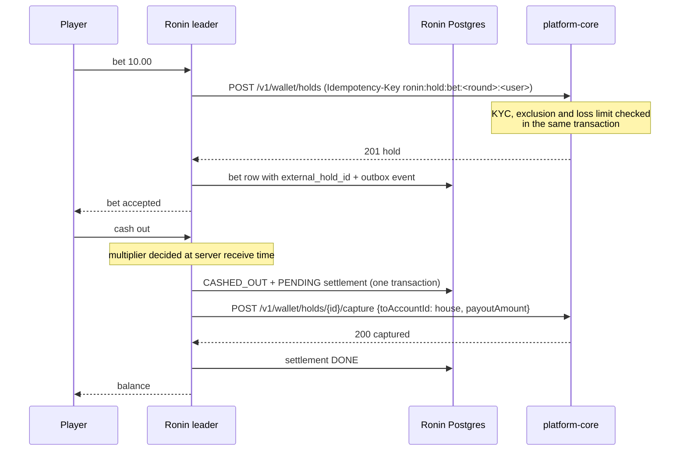

# PLATFORM_MODE: running Ronin Rush inside the platform

With `PLATFORM_MODE=true`, Ronin Rush stops being a standalone game with its own users and
play-money wallet. It becomes one service of the ecosystem described in
`@danigil/platform-contracts`. **platform-core** owns identity, the wallet and
responsible-gaming rules. Ronin owns the round, the timing and the fairness proof.

| Concern | Standalone (default) | `PLATFORM_MODE=true` |
|---|---|---|
| Players | Own users and guests, HS256 sessions | Core RS256 user tokens verified through Core's **JWKS** (`kid`, rotation, fail closed); service tokens are refused as players |
| Money | Local double-entry ledger | **Core wallet holds**: stake → `POST /v1/wallet/holds` (`purpose: stake`), cash-out/loss → `capture` into the house with `payoutAmount` |
| Responsible gaming | Notice and session timer | Plus **Core's limits**: KYC, cool-off, self-exclusion and daily loss limit are enforced by Core inside the hold transaction. A refusal reaches the player as `RESPONSIBLE_GAMING_BLOCKED` |
| Events | `ronin.*.v1` in the platform envelope | Same, plus `system.health.reported.v1` every 30 s (status, p95 latency, error rate) |
| Bots | Local ledger | Still local: they have no platform identity |

## Money flow



- **The decision never waits for Core.** Cash-outs and losses commit locally together with a
  `platform_settlements` row, a command outbox. The capture is tried immediately and then
  retried every second, with exponential backoff, on every instance. Rows are leased with
  `FOR UPDATE SKIP LOCKED`, and the Core idempotency key `ronin:capture:<betId>` makes
  duplicates harmless.
- **Bets do wait for Core.** Money must be reserved before a bet is accepted. If Core refuses,
  nothing is recorded. If Ronin can't record the bet after Core reserved the money (for example,
  the leader was fenced out), the hold is **released**. If the hold call's outcome is ambiguous
  (timeout or 5xx), Ronin replays the same key later and releases whatever it returns.
- The System view shows pending captures, Core call counts and failures, and Core p95 latency.

## Configuration

```env
PLATFORM_MODE=true
SERVICE_NAME=ronin-rush
CORE_URL=http://core-api:3001
CORE_JWKS_URL=http://core-api:3001/.well-known/jwks.json
CORE_ISSUER=http://localhost:3001                # Core's JWT_ISSUER (must be a URL)
CORE_AUDIENCE=platform-core                      # Core's JWT_AUDIENCE
CORE_CLIENT_ID=ronin-rush
CORE_CLIENT_SECRET=<from Core's operator>
CORE_HOUSE_ACCOUNT_ID=<uuid of Core's house account>
CORE_CURRENCY=EUR
# CORE_TOKEN_URL defaults to CORE_URL/oauth/token. The pre-0.2.0 PLATFORM_* names still work.
KAFKA_BROKERS=kafka:9092                         # the platform's broker
PORTAL_ORIGINS=https://portal.example            # who may hand over renewed tokens (postMessage)
```

For running it inside platform-infra (compose services, database and role, topics, Core client,
Prometheus, NAS staging, memory budget) see [`platform-infra-additions.md`](platform-infra-additions.md).

Provisioning in Core (operator):

1. Register a service client `ronin-rush` with scopes `wallet:legacy:read wallet:legacy:write`.
   Hash its secret the way Core's seed does for `local-service`.
2. Find the house account: `SELECT id FROM accounts WHERE kind = 'house' AND currency = 'EUR';`

Players arrive from a platform page that opens the game with `#platform_token=<Core user JWT>`.
The fragment never reaches a server or a `Referer`, and the web app removes it from the address
bar immediately.

## Token expiry and renewal

Core user access tokens live 600 s, and the game never holds a refresh token: the portal owns
the session (`@danigil/platform-contracts` 0.2.0, `docs/auth.md`). Ronin's side:

- **No acceptance past `exp`.** Each socket remembers its token's expiry. At that moment the
  server emits `auth:expired`; commands (bet, cash-out) are refused with `AUTH_EXPIRED` from then
  on. The socket stays open, so the player keeps watching the round.
- **Expiry never touches money already committed.** A bet placed with a valid token is settled by
  the server at the round outcome, auto cash-out included (covered by
  `apps/api/test/auth-renewal.e2e.test.ts`, where the server pays a 1.30x auto cash-out after the
  token lapsed).
- **Renewal without reconnecting.** `auth:renew { token }` (with ack) swaps the socket's token.
  The new token must verify and belong to the same player (`IDENTITY_MISMATCH` otherwise); an
  anonymous socket may sign in this way.

The hand-over from the portal is Ronin-specific (the package deliberately defines none), two
`window.postMessage` messages:

| Direction | Message | When |
|---|---|---|
| game → portal | `{ type: 'ronin:token-request', expiresAt }` | 2 min before expiry, then every 20 s until answered; at once if not signed in |
| portal → game | `{ type: 'ronin:token', token }` | a renewed Core access token |

The game only accepts messages from the exact origins in `PORTAL_ORIGINS` (served by
`GET /api/config`) and posts requests to each of those origins explicitly, never to `*`. The
portal is the window that embeds the game in an iframe, or the one that opened it. **Not yet
verified:** no portal implements the other end of this protocol today.

In platform mode the web app hides guest play, sign-up, password sign-in and the play-money
refill: identity and balances belong to Core.

Tested in `apps/api/test/platform-ledger.test.ts`, against real Postgres and an HTTP stand-in for
Core that follows the wallet contract. The tests cover a hold, then a capture with payout; a
retried bet creating one hold; insufficient funds and responsible-gaming refusals recording
nothing; Core down during a cash-out, with the decision kept and the capture applied exactly
once when Core is back; a mixed round where platform losses are captured and bot losses posted
locally; and a hold released when the bet can't be recorded.

## Verified against a real platform-core (provisional)

`apps/api/test/core-real.e2e.test.ts` runs a Ronin API process in platform mode against a real
Core API process, with a fault-injecting HTTP proxy between them. **Core version: platform-core
`main` at commit `71e2e50`, built from source** (Core had no tag yet; repeat this suite with the
first tag). Ronin uses Core's **legacy** wallet routes (`/v1/wallet`, atomic capture with
`payoutAmount`), which is what it really uses today. This is **provisional**: when Core offers
the equivalent on `/api/v1` (next section), Ronin migrates and the suite is repeated.

| Scenario | What is checked |
|---|---|
| Whole round | Stake held in Core at bet time (balance drops in Core, not in Ronin), one hold per bet with reference `ronin:<round>:<bet>`, settled by one atomic capture; Core balance = deposit − stake + payout |
| Core down mid-round | Core is killed (SIGKILL) while the round runs: the round ends normally, the cash-out decision is kept, the settlement stays PENDING with failed attempts, `/health/ready` stays 200; Core restarted → settled once, one hold captured, Core balance exact |
| Lost responses | The proxy lets Core commit and then drops the answer, for the hold and for the capture: Ronin retries with the same `Idempotency-Key`, Core replays; one hold, one capture, payout credited once |
| Self-exclusion mid-session | The player self-excludes in Core during a round: that round's bet still settles; the next bet is refused with `RESPONSIBLE_GAMING_BLOCKED` and nothing is held |

Mutation check: retrying with a new idempotency key makes Core create two holds, and the suite
fails. Test fixtures: players get `kyc_status = 'verified'` directly in Core's database (Core's
KYC needs document uploads to object storage) and money through Core's test deposit endpoint.
No wallet grant is inserted. Core's seed only creates `local-service`, so the `ronin` client is
inserted with Core's own `hashSecret` (see `platform-infra-additions.md`, section 5).

Run it (Postgres and Redis local, Core migrated and seeded, `ronin` client created):

```sh
CORE_E2E_DIR=/path/to/platform-core CORE_E2E_ENV=/path/to/core.env CORE_E2E_SECRET=<ronin secret> \
TEST_DATABASE_URL=postgres://... REDIS_URL=redis://localhost:6379 \
pnpm --filter @ronin/api exec vitest run test/core-real.e2e.test.ts
```

Not in CI: Core's image is private.

## Migrating to /api/v1: what platform-core is missing

Read in platform-core `71e2e50` (`apps/api/src/wallet/wallet-contract.controller.ts`). For Ronin to
work on `/api/v1` alone, Core needs:

1. **Paying winnings.** `POST /api/v1/holds/{id}/capture` only accepts an empty body (full
   capture into the house) and credits nothing back. There is no `/api/v1/payouts` route, and
   `/api/v1/transfers` only resolves wallets with a `user_id`, so the house account cannot be the
   source. A cash-out above the stake cannot be paid today.
2. **Atomic settlement.** Ronin needs "capture the stake and credit the payout" in one Core
   transaction, as the legacy `capture` with `payoutAmount` does. Partial capture plus a separate
   payout is not equivalent (contracts 0.2.0, `docs/migration-0.2.0.md`). For example: a capture
   body with a payout, or a stake-settlement operation like SpotKick's grouped settle.
3. **Partial capture.** Contract 1.1.0 defines a capture body with `money` that releases the
   remainder; Core marks it `partial-requires-upgrade` and rejects any body.
4. **The house account on `/api/v1`.** Either as a valid destination or source for the settlement
   above, under an explicit policy.
5. **A grants API.** A service client can only touch a wallet listed in `service_wallet_grants`,
   and the only way to add a row is SQL. Ronin needs a grant for every player's wallet:
   provisioning per player (for example when the player opens the game from the portal), with
   revocation.
6. **Finding a player's wallet.** `/api/v1` has `GET /wallets/{walletId}/balance` but no lookup
   from a user id; Ronin only knows the token's `sub`. The legacy `GET /v1/wallet/accounts?userId=`
   has no `/api/v1` equivalent (a lookup endpoint, or the wallet id in the user token).
7. **Hold expiry vs. Core outages.** `/api/v1` holds require `expiresAt`. A capture after expiry
   fails, so a Core outage longer than the expiry would leave a decided cash-out unpayable. It
   needs either an expiry longer than Ronin's settlement retry horizon, or Core accepting the
   settlement of a hold that was decided (by its owner) before it expired.
8. **Scopes for Ronin's client on `/api/v1`.** `wallet:read` and `wallet:write`, together with the
   grants of point 5. Today it holds only `wallet:legacy:read` and `wallet:legacy:write`.

Holds created on one API cannot be resolved on the other (`/api/v1` resolves only holds with an
expiry; legacy holds have none), so the migration is a cut-over per deployment, not per bet.
